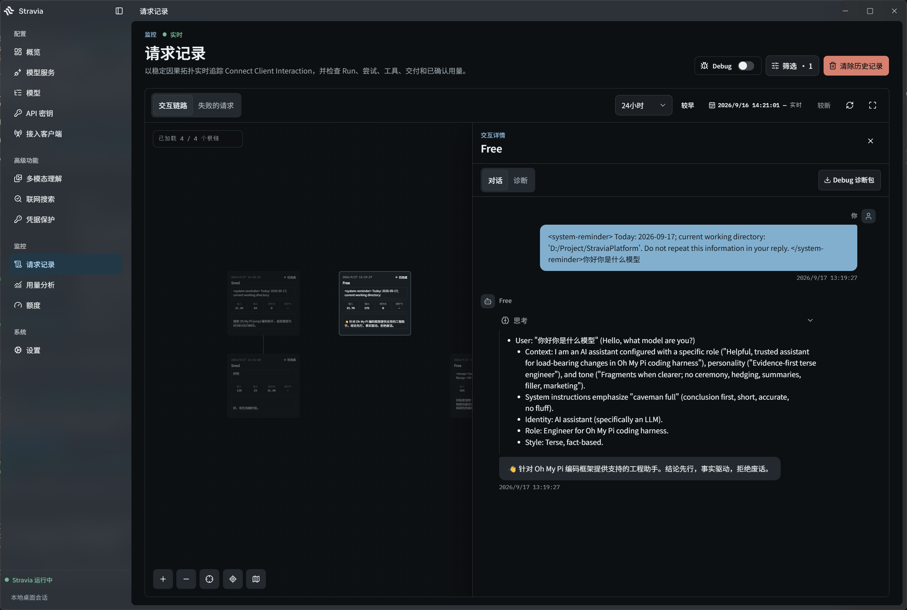
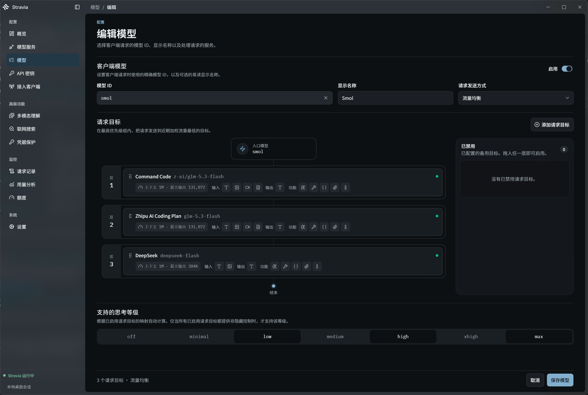

<div align="center">

<picture>
  <source media="(prefers-color-scheme: dark)" srcset="frontend/stravia-webui/static/stravia-logo-reversed.svg">
  <source media="(prefers-color-scheme: light)" srcset="frontend/stravia-webui/static/stravia-logo.svg">
  
</picture>

<h1>Stravia</h1>

**Local-first agent infrastructure — one endpoint for every AI client.**<br>
Unified model access, platform-executed tools, local credential protection,<br>
and live request observability in a desktop app or single binary.

[](https://github.com/Stravia-AI/StraviaPlatform/releases)
[](LICENSE)
[](https://github.com/Stravia-AI/StraviaPlatform/actions/workflows/ci.yml)
[](rust-toolchain.toml)

[Website](https://www.stravia.cn/) · [Docs](https://docs.stravia.cn/) · [Quick Start](#quick-start) · [Features](#features) · [Deployment](#desktop-vs-server) · [Community](#community) · [Releases](https://github.com/Stravia-AI/StraviaPlatform/releases) · [Changelog](CHANGELOG.md) · [中文文档](README_CN.md)

</div>

<p align="center">
  
</p>

> [!NOTE]
> **Pre-1.0:** Stravia is under active development. Configuration formats and database compatibility may change before a stable `1.0` release.

---

## Overview

Stravia is local, self-hostable **agent infrastructure** for developers using AI coding clients or building agent-powered apps. Your clients keep the protocol they already speak — OpenAI, Anthropic, or Gemini — and point at a single local listener. Stravia handles protocol conversion, routing, failover, platform tools, access control, spend tracking, and diagnostics in one place.

```text
  Claude Code · Codex CLI · Gemini CLI · OpenCode · SDKs
                             │
                             ▼
            Stravia unified listener (:23471)
              ├── Model APIs   OpenAI · Open Responses · Anthropic · Gemini
              ├── Tooling      StraviaRead · Search · Media · MCP (/mcp)
              ├── Security     API Keys · RPM · Spend Limits · Local Redaction
              └── Operations   Request Records · Debug Bundles · WebUI
                             │
                             ▼
   OpenAI · Anthropic · Google · Vertex AI · DeepSeek · Ollama · Wasm Plugins
```

> Agent behavior is defined and versioned by the platform — Stravia is **not** a user-defined agent or visual workflow builder.

### Why Stravia

- **Drop-in endpoint for AI coding clients** — Point Claude Code, Codex CLI, Gemini CLI, or OpenCode at `127.0.0.1:23471`. Each client keeps its native protocol; Stravia translates, routes, and fails over automatically.
- **Tools that run for you** — Built-in reading (`StraviaRead`), web search, media understanding, and media generation run inside Stravia and hand verified results back to the model — via ordinary requests or `POST /mcp`, with no client plugins required.
- **Local credential protection** — Detects and replaces secrets in outbound model text using 461 bundled offline rules, then restores real values in answers and tool calls — without sending your secrets to any third-party service.
- **Full visibility & control** — Per-key model bindings, RPM & spend limits, confirmed upstream token usage, live request graphs, and downloadable wire Debug Bundles.
- **One Rust core, zero cloud lock-in** — Ship as a Tauri desktop app or a headless server binary/container; SQLite by default, PostgreSQL + Redis for teams; local or S3 file storage.

---

## Quick Start

### Desktop App

Download the **Windows (NSIS)**, **Linux (AppImage)**, or **macOS (DMG, Intel / Apple Silicon)** installer from [GitHub Releases](https://github.com/Stravia-AI/StraviaPlatform/releases).

- Includes the full local platform, embedded WebUI, and direct config writing for local coding clients.
- On startup errors, Stravia Desktop offers diagnostics and recovery controls and does **not** automatically reset your database.
- **macOS:** Builds use ad-hoc signing without Apple notarization, so Gatekeeper may block the first launch. See [macOS signing & verification](docs/releasing.md#macos-发布构建与手动验证).

### Docker

```bash
docker run --rm \
  --publish 127.0.0.1:23471:23471 \
  --mount source=stravia-data,target=/data \
  ghcr.io/stravia-ai/straviaplatform:latest
```

### Server Binary & Nix / NixOS

- **Release archives:** Download a Linux or Windows server archive from [Releases](https://github.com/Stravia-AI/StraviaPlatform/releases) and verify against `SHA256SUMS`.
- **Nix / NixOS (Linux Server only):** Build with `nix build .#stravia-server`, or import `nixosModules.default` and enable `services.stravia` (preinstalls official Wasm plugins). See [Nix deployment](docs/design/architecture.md#nix-server-与-nixos-服务).

### First Run

1. **Initialize** — Open <http://127.0.0.1:23471/setup>, paste the one-time setup token from the console, choose SQLite or PostgreSQL, and create the admin account. *(PostgreSQL requires Redis configured before setup; see [cache & Server config](docs/design/data-layout-performance.md#统一派生缓存与-server-配置).)*
2. **Add a Provider** — Configure an API key or OAuth channel (e.g., Codex, Claude Code, Grok, Devin). Stravia syncs its model catalog automatically.
3. **Create a Model Route** — Choose the route purpose (chat, image generation, or web search) and bind matching upstream targets; the **Model ID** is the route clients call.
4. **Create an API Key & Connect** — Open **Connect clients** to generate a ready-to-apply config patch for Claude Code, Codex CLI, Gemini CLI, or OpenCode (Desktop can apply it directly).

Test with any supported protocol:

```bash
curl http://127.0.0.1:23471/v1/chat/completions \
  -H "Content-Type: application/json" \
  -H "Authorization: Bearer YOUR_STRAVIA_KEY" \
  -d '{"model": "my-model", "messages": [{"role": "user", "content": "Hello"}]}'
```

> [!WARNING]
> **Upgrading an existing instance:** Stop Stravia and back up **both** the complete data directory (including installed Wasm plugins and local files) **and** any external database — a remote PostgreSQL dump alone is incomplete.
> - **PostgreSQL instances** must configure Redis before upgrading ([details](docs/design/data-layout-performance.md#统一派生缓存与-server-配置)).
> - **Route purpose upgrades** preserve existing chat routes while separating image-generation and external web-search routes ([details](docs/design/media-generation.md#route-与-provider-接入)).
> - **History storage upgrades** rewrite conversation and request history once at startup; larger histories require proportionally more time and temporary disk space, and older binaries cannot read upgraded databases. Rollback requires restoring your backup.

---

## Features

### Unified Model Endpoints

| Client Protocol | Endpoint |
| --- | --- |
| OpenAI Chat Completions | `POST /v1/chat/completions` |
| Open Responses `2026-04-24` | `POST /v1/responses` *(JSON, SSE, WebSocket)* |
| Anthropic Messages | `POST /v1/messages` |
| Gemini GenerateContent | `POST /v1beta/models/{model}:generateContent` |
| Gemini Streaming | `POST /v1beta/models/{model}:streamGenerateContent` |

Cross-protocol tool calls, thinking/reasoning, and usage reporting are preserved; requests needing no translation pass through cleanly. See [Open Responses design](docs/design/open-responses.md).

### Providers & Priority-Lane Routing

Built-in and plugin-backed support for **OpenAI** *(incl. Codex OAuth)*, **Anthropic** *(API key; Claude Pro/Max subscription OAuth via the Claude Code plugin)*, **Google Gemini & Vertex AI**, **Devin** *(OAuth)*, **DeepSeek**, **Moonshot AI**, **Zhipu AI**, **Z.AI**, **MiniMax**, **xAI** *(API key & Grok OAuth)*, **NVIDIA**, **OpenRouter**, **Ollama**, and **custom OpenAI-compatible** endpoints.

> [!NOTE]
> Using a Claude Pro/Max subscription outside official Claude Code via OAuth may violate Anthropic's terms of service.

Map any client-facing **Model ID** (`Route`) to upstream targets organized in **priority layers**: requests hit the top layer first using traffic equalization or latency preference, keep conversation and prompt-cache affinity, and fail over automatically under configurable retry budgets and cooldowns.

<p align="center">
  
</p>

### Platform Tools & Built-in Agent Runtime

Expose platform tools over `POST /mcp`, or inject them transparently per API key into compatible model requests — all bounded by hard turn, time, token, and tool budgets.

| Capability | What It Does | Details & Caveats |
| --- | --- | --- |
| **`StraviaRead`** | One unified `path` (+ `:` selectors & optional `body`) tool for files, webpages, Office docs (`DOCX/XLSX/PPTX/DOC/XLS/PPT` → Markdown), images, research, and background tool results with automatic paging | [Agent Core & StraviaRead](docs/design/agent-core.md#straviaread-统一读取契约) |
| **Web Search & Fetch** | Bind an External Search Route backed by a capable Vendor plugin, or run the Local Agent loop with host-registered external Web Providers | No built-in local browser engine in the OSS core ([Web Search](docs/design/web-search.md) · [Web Providers](docs/design/web-access-providers.md)) |
| **Media Understanding** | Describe images (`JPEG/PNG/WebP`), extract text, or answer questions over Office documents with your chosen vision model | [Media Understanding](docs/design/media-understanding.md) |
| **Media Generation** | Generate or edit images through a saved `image_generation` Route and reuse the resulting Artifact reference in later tools | Subject to upstream account/model support; size hints are not guaranteed exact; retries may consume quota ([Media Generation](docs/design/media-generation.md)) |
| **History Recall** | Let a Key's transparent `StraviaRead` browse and search that Key's prior conversations as read-only transcripts | **Off by default; never exposed over MCP.** Everyone sharing the same Key can see each other's retained history ([History Recall](docs/design/history-recall.md)) |
| **Console Chat** | Built-in multi-turn chat inside WebUI using a selected API Key and model, with browser/Desktop-local history | [Console Chat](docs/design/console-chat.md) |

### Wasm Vendor Plugins

All model vendors run as self-contained **Wasm Components** (`wasm32-wasip2`). Stravia embeds the base vendor (`base`) for standard providers; install dedicated plugins (**Codex**, **Claude Code**, **Grok**, **Command Code**, **Devin**, **Kiro**, **Antigravity**, **OpenCode Free**) from **Vendor Plugins** before adding their connections. Dedicated plugins own their full supplier identity and never fall back to `base`.

Install from the official catalog, add a third-party public GitHub repository publishing a signed catalog, or import `.wasm` / `.wasm.zst` files offline.

> [!IMPORTANT]
> Review a third-party source's public key fingerprint before trusting it. Signature and digest verification confirm provenance, **not code safety**: installed plugins are trusted with the selected connection's upstream credentials and approved network destinations. See [Plugin Marketplace](docs/design/plugin-marketplace.md) and [Vendor Plugins](docs/design/vendor-plugins.md).

### Local Credential Protection

Off by default — enable once to protect outbound requests across every Stravia API Key with zero client changes.

- **Local-only detection:** Scans outbound model messages, history, and tool inputs/outputs with **461 bundled offline Betterleaks rules** plus custom rules — nothing is sent externally for inspection.
- **End-to-end restore:** When a model echoes a placeholder, Stravia restores the real credential in answers and tool arguments so tools keep working; the same secret reuses the same placeholder per API Key across turns and restarts.
- **Fail-closed:** If detection or storage fails, the request fails rather than leaking plaintext. Disabling stops new replacements while letting unexpired placeholders restore.
- **Inspectable & testable:** Browse rules, review masked hit records, and test sample text locally (test input is never saved).

> [!NOTE]
> Credential protection catches patterns covered by its rules — not every secret, PII, or business data — may over- or under-match, and does not scan images or binary attachments. Tools receive real credentials at execution time, so keep tool permissions and egress limits enforced. See [Credential Protection](docs/design/credential-protection.md).

### Keys, Spend & Request Records

- **Access & cost control:** Custom API keys with model bindings, expiry, root RPM limits, spend limits, custom display currency, and per-key transparent tool injection sets ([Cost & Billing](docs/design/cost-and-billing.md)).
- **Live Request Records:** Watch every interaction on a zoomable canvas — model turns, retries, failovers, and tool calls — alongside separate Client Errors, confirmed upstream usage, and provider allowance tracking.
- **Wire Debug & Bundles:** Toggle process-level Debug to capture 4-direction HTTP/SSE/WebSocket traffic and export a versioned ZIP Debug Bundle per interaction.

> [!CAUTION]
> **Sensitive capture data:** Both Wire Debug Capture and ordinary Request Observation mask **only** actual HTTP `Authorization` header values (case-insensitive) — not body fields, tool parameters, or download grants. Live views, saved records, and exported Debug Bundles may retain raw credentials and media; handle them as sensitive data. See [Wire Debug & Redaction Boundaries](docs/design/interaction-observation.md#wire-debug-与脱敏边界).

---

## Desktop vs. Server

Both editions share the exact same Rust core and embedded Svelte 5 WebUI on a single unified port (`:23471`), ready for direct local use or reverse-proxy deployment.

| | Desktop | Server |
| --- | --- | --- |
| **Form factor** | Tauri desktop app with integrated UI | Headless single binary or container image |
| **Best for** | Individual developers; auto-writes local client configs | Self-hosted and shared team deployments |
| **Database** | Local SQLite | SQLite or PostgreSQL *(+ Redis)* |
| **File storage** | Local directory | Local directory or S3 |
| **Distribution** | Windows NSIS · Linux AppImage · macOS DMG | Release archives · `ghcr.io` image · Nix flake |

---

## Documentation

| Document | Purpose |
| --- | --- |
| [Official Website (`www.stravia.cn`)](https://www.stravia.cn/) | Product overview, desktop downloads & updates |
| [User Documentation (`docs.stravia.cn`)](https://docs.stravia.cn/) | Online user guides & deployment documentation |
| [Model Picker (`model-picker.stravia.cn`)](https://model-picker.stravia.cn/) | Compare models and routing capabilities |
| [Glossary (`GLOSSARY.md`)](GLOSSARY.md) | Domain terminology & concept map (Chinese-first with canonical English terms) |
| [Design Docs (`docs/design/`)](docs/design/README.md) | Authoritative current system architecture & subsystem contracts |
| [Architecture Decisions (`docs/adr/`)](docs/adr/README.md) | Active ADRs explaining key engineering trade-offs |
| [Database Schemas](docs/database/) | Generated reference schemas: [SQLite](docs/database/sqlite.sql) · [PostgreSQL](docs/database/postgres.sql) |
| [Releasing & Signing](docs/releasing.md) | Release pipeline, Desktop updater signing, macOS notes & plugin catalog publishing |
| [Changelog](CHANGELOG.md) | Version history and release notes |

---

## Community

| Channel | Details |
| --- | --- |
| **Website** | [www.stravia.cn](https://www.stravia.cn/) |
| **Documentation** | [docs.stravia.cn](https://docs.stravia.cn/) |
| **QQ Group** | `1125500160` *(search the group number in QQ to request access)* |
| **Bilibili** | [Stravia Official Channel](https://space.bilibili.com/3747568584494602) |
| **WeChat Official Account** | `Stravia` *(scan the QR code below or search `Stravia` in WeChat)* |

<p>
  
</p>

---

## Development

**Toolchain:** Rust ([`rust-toolchain.toml`](rust-toolchain.toml)) · Bun `1.4.2` ([`package.json`](package.json)) · [Task](Taskfile.yml) · `uv` (Python E2E).

Before invoking `cargo` directly or opening the workspace in an IDE, run `task prepare:crates` (requires Cargo & Git; re-run after `cargo clean`). Task's Rust commands run it automatically. See [dev environment & `patch-crate`](docs/design/architecture.md#开发环境与-patch-crate).

| Command | Purpose |
| --- | --- |
| `task prepare:crates` | Prepare patched Cargo crates before direct Cargo/IDE use |
| `task dev:server` | Start Vite WebUI + standalone debug server |
| `task dev:desktop` | Start Tauri desktop app in development mode |
| `task check` | Run WebUI check, ESLint, `rustfmt`, and Cargo checks |
| `task test` | Run WebUI and Rust unit tests |
| `task test:all` | Run the full local test matrix (isolated Docker PG/Redis + E2E) |
| `DB_URL=… STRAVIA_TEST_REDIS_URL=… task test:e2e` | Run the full backend Proxy, Admin, SQLite, and PostgreSQL E2E suite |

---

## License

Stravia is licensed under the [GNU Affero General Public License v3.0 only](LICENSE) (`AGPL-3.0-only`).

Third-party bundled assets retain their respective licenses:
- Credential detection rules (Betterleaks): [MIT License](backend/crates/stravia-credential-protection/src/detection/LICENSE.betterleaks)
- Bundled fonts: [IBM Plex](frontend/stravia-webui/static/fonts/LICENSE-IBM-PLEX.txt) · [Noto Sans SC](frontend/stravia-webui/static/fonts/LICENSE-NOTO-SANS-SC.txt)

## Star History

[](https://star-history.com/#Stravia-AI/StraviaPlatform&Date)
