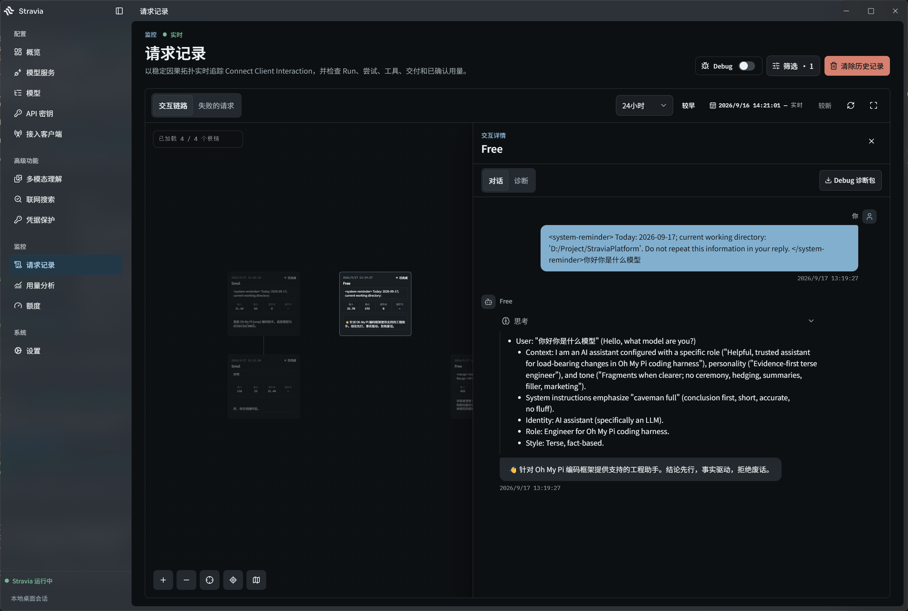
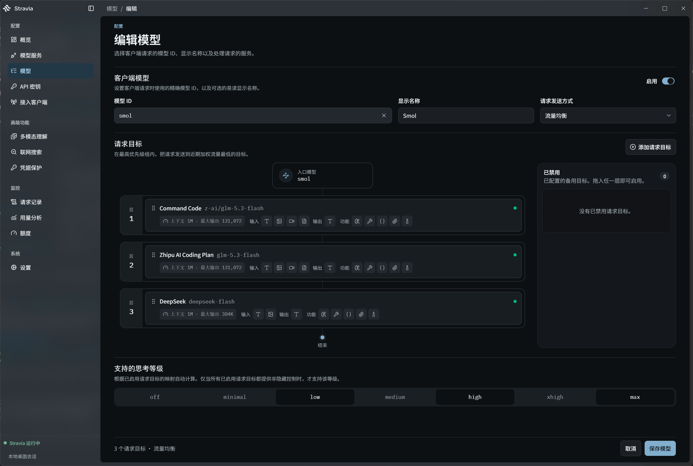

<div align="center">

<picture>
  <source media="(prefers-color-scheme: dark)" srcset="frontend/stravia-webui/static/stravia-logo-reversed.svg">
  <source media="(prefers-color-scheme: light)" srcset="frontend/stravia-webui/static/stravia-logo.svg">
  
</picture>

<h1>Stravia</h1>

**本地优先的 Agent 基础设施 —— 一个端点接入所有 AI 客户端。**<br>
统一模型接入、平台代跑工具、本地凭据保护，<br>
以及实时请求可观测性 —— 桌面应用或单一二进制开箱即用。

[](https://github.com/Stravia-AI/StraviaPlatform/releases)
[](LICENSE)
[](https://github.com/Stravia-AI/StraviaPlatform/actions/workflows/ci.yml)
[](rust-toolchain.toml)

[官网](https://www.stravia.cn/) · [在线文档](https://docs.stravia.cn/) · [快速开始](#快速开始) · [核心特性](#核心特性) · [部署形态](#桌面端-vs-服务端) · [社区交流](#社区与关注) · [发布版本](https://github.com/Stravia-AI/StraviaPlatform/releases) · [更新日志](CHANGELOG.md) · [English](README.md)

</div>

<p align="center">
  
</p>

> [!NOTE]
> **Pre-1.0 提示：** Stravia 尚未发布 `1.0`，仍在积极演进中。稳定版发布前，配置格式与数据库兼容性可能发生变化。

---

## 简介

Stravia 是本地运行、可自托管的 **Agent 基础设施（Agent infra）**，面向使用 AI 编程客户端或构建智能体应用的开发者。你的客户端无需修改协议 —— OpenAI、Anthropic、Gemini 照旧 —— 只需指向同一个本地端口。Stravia 在同一套 Rust 内核中统一完成协议转换、路由与故障切换、平台工具执行、访问控制、费用统计与全链路诊断。

```text
  Claude Code · Codex CLI · Gemini CLI · OpenCode · 各类 SDK
                             │
                             ▼
            Stravia 统一监听端口 (:23471)
              ├── 模型接口   OpenAI · Open Responses · Anthropic · Gemini
              ├── 平台工具   StraviaRead · 联网搜索 · 多模态 · MCP (/mcp)
              ├── 安全控制   API Key · 限流 · 消费上限 · 本地可逆脱敏
              └── 可观测性   实时请求记录 · 线级调试包 · 内嵌 WebUI
                             │
                             ▼
   OpenAI · Anthropic · Google · Vertex AI · DeepSeek · Ollama · Wasm 插件
```

> Agent 行为由平台实现定义并做版本管理 —— Stravia **不是**用户自定义 Agent 或可视化工作流搭建器。

### 为什么选择 Stravia

- **AI 编程客户端的即插即用端点** —— 把 Claude Code、Codex CLI、Gemini CLI 或 OpenCode 指向 `127.0.0.1:23471` 即可工作。客户端保留原生协议，转换、选路与故障切换全由 Stravia 接管。
- **替你运行的平台工具** —— 内置统一读取（`StraviaRead`）、联网搜索、多模态理解与媒体生成在 Stravia 内部执行并把经校验的结果交回模型，支持普通请求透明注入或 `POST /mcp`，客户端无需装插件。
- **本地离线凭据保护** —— 内置 461 条离线规则自动检测并替换发往模型的密钥，并在回答与工具参数中原样还原，秘密全程不出本机。
- **密钥、用量与请求全景** —— 按 Key 配置模型权限、RPM 与消费上限，展示上游真实上报用量，提供可缩放实时请求画布与可导出的四方向线级调试包。
- **单一 Rust 核心，零云端绑定** —— 桌面应用或无头服务端/容器任选；默认 SQLite，团队可用 PostgreSQL + Redis；文件支持本地或 S3 存储。

---

## 快速开始

### 桌面应用

从 [GitHub Releases](https://github.com/Stravia-AI/StraviaPlatform/releases) 下载 **Windows（NSIS）**、**Linux（AppImage）** 或 **macOS（DMG，Intel / Apple Silicon）** 安装包。

- 本地完整运行平台与内嵌 WebUI，支持直接把配置写入本机编程客户端。
- 启动异常时提供诊断与恢复入口，**不会**自动重置你的数据库。
- **macOS 说明：** 构建采用 Ad-hoc 签名、未经 Apple 公证，首次启动可能被 Gatekeeper 拦截，处理方式见[发布与签名说明](docs/releasing.md#macos-发布构建与手动验证)。

### Docker

```bash
docker run --rm \
  --publish 127.0.0.1:23471:23471 \
  --mount source=stravia-data,target=/data \
  ghcr.io/stravia-ai/straviaplatform:latest
```

### 服务端二进制与 Nix / NixOS

- **发布压缩包：** 从 [Releases](https://github.com/Stravia-AI/StraviaPlatform/releases) 下载 Linux 或 Windows 服务端压缩包，并对照 `SHA256SUMS` 校验。
- **Nix / NixOS（仅 Linux Server）：** 运行 `nix build .#stravia-server` 构建，或导入 `nixosModules.default` 并启用 `services.stravia`（预装全部官方 Wasm 插件）。详见 [Nix 部署说明](docs/design/architecture.md#nix-server-与-nixos-服务)。

### 首次启动（四步上手）

1. **初始化实例** —— 打开 <http://127.0.0.1:23471/setup>，粘贴控制台输出的一次性设置令牌，选择 SQLite 或 PostgreSQL 并创建管理员。*（选择 PostgreSQL 须先配置 Redis，见[缓存与 Server 配置](docs/design/data-layout-performance.md#统一派生缓存与-server-配置)。）*
2. **添加供应商连接（Provider）** —— 配置 API Key 或 OAuth 通道（Codex、Claude Code、Grok、Devin 等），Stravia 会自动同步可用模型清单。
3. **创建模型路由（Route）** —— 选择路由用途（对话推理、图片生成或联网搜索）并绑定匹配的上游目标；**Model ID** 即客户端调用名称。
4. **创建 API Key 并接入客户端** —— 打开**接入客户端**，为 Claude Code、Codex CLI、Gemini CLI 或 OpenCode 生成配置补丁（桌面端支持直接写入）。

随后即可通过任意受支持协议调用：

```bash
curl http://127.0.0.1:23471/v1/chat/completions \
  -H "Content-Type: application/json" \
  -H "Authorization: Bearer YOUR_STRAVIA_KEY" \
  -d '{"model": "my-model", "messages": [{"role": "user", "content": "Hello"}]}'
```

> [!WARNING]
> **升级已有实例前必读：** 请先停机，并**配套备份**完整数据目录（含已安装的 Wasm 插件与本地文件）以及外部数据库 —— 仅备份远程 PostgreSQL 并不完整。
> - **既有 PostgreSQL 实例** 升级前必须先配置 Redis（[详见此处](docs/design/data-layout-performance.md#统一派生缓存与-server-配置)）。
> - **路由用途迁移** 会保留原有对话路由，并将图片生成与外部联网搜索路由独立区分（[详见此处](docs/design/media-generation.md#route-与-provider-接入)）。
> - **历史存储升级** 会在启动时一次性改写已有对话与请求历史；历史越大耗时越长、所需临时空间越多，且旧版本无法读取升级后的数据库。回退必须恢复备份。

---

## 核心特性

### 统一模型接口

| 客户端协议 | 端点 |
| --- | --- |
| OpenAI Chat Completions | `POST /v1/chat/completions` |
| Open Responses `2026-04-24` | `POST /v1/responses` *（JSON、SSE、WebSocket）* |
| Anthropic Messages | `POST /v1/messages` |
| Gemini GenerateContent | `POST /v1beta/models/{model}:generateContent` |
| Gemini 流式生成 | `POST /v1beta/models/{model}:streamGenerateContent` |

跨协议完整保留工具调用、思考/推理与用量统计；无需转换的请求直接透传。详见 [Open Responses 设计](docs/design/open-responses.md)。

### 供应商接入与优先级泳道路由

内置及插件支持 **OpenAI** *（含 Codex OAuth）*、**Anthropic** *（API Key；Claude Pro/Max 订阅 OAuth 由 Claude Code 插件提供）*、**Google Gemini 与 Vertex AI**、**Devin** *（OAuth）*、**DeepSeek**、**Moonshot AI**、**智谱 AI**、**Z.AI**、**MiniMax**、**xAI** *（API Key 与 Grok OAuth）*、**NVIDIA**、**OpenRouter**、**Ollama** 及**自定义 OpenAI 兼容**端点。

> [!NOTE]
> 在官方 Claude Code 之外通过 OAuth 使用 Claude Pro/Max 订阅可能违反 Anthropic 服务条款，请自行评估风险。

将任意面向客户端的 **Model ID（Route）** 映射到按**优先级泳道**分层的多个上游目标：优先走最高层，同层按流量均衡或延迟偏好调度，兼顾会话与提示词缓存亲和，并在可配置的重试预算与冷却策略下自动故障切换。

<p align="center">
  
</p>

### 平台工具与内置 Agent 运行时

所有能力既可通过 `POST /mcp` 暴露，也可按 API Key 透明注入兼容模型请求，并在时间、轮次、token 与工具硬预算内安全运行。

| 能力 | 功能说明 | 文档与边界提示 |
| --- | --- | --- |
| **`StraviaRead`** | 统一通过单个 `path`（含 `:` 选择器与可选 `body`）读取文件、网页、Office 文档（`DOCX/XLSX/PPTX/DOC/XLS/PPT` → Markdown）、图片、研究查询与后台工具结果，长文本自动分页 | [Agent Core 与 StraviaRead](docs/design/agent-core.md#straviaread-统一读取契约) |
| **联网搜索与网页读取** | 可绑定具备完整搜索能力的 Vendor 插件外部路由，或在宿主注册外部 Web Provider 后使用 Local Agent 循环 | 开源核心不内置本地浏览器引擎（[联网搜索](docs/design/web-search.md) · [Web Provider 扩展](docs/design/web-access-providers.md)） |
| **多模态理解** | 用你选定的视觉模型描述图片（`JPEG/PNG/WebP`）、提取文字或问答 Office 文档 | [多模态理解](docs/design/media-understanding.md) |
| **媒体生成** | 通过已保存的 `image_generation` 路由生成或编辑图片，并用 Artifact 引用在后续工具中复用 | 可用性取决于上游账号与模型；尺寸偏好不保证精确；重试可能额外消耗额度（[媒体生成](docs/design/media-generation.md)） |
| **历史回看** | 允许开启该项的 Key 经透明注入的 `StraviaRead` 以只读转录方式浏览、检索该 Key 保留期内的历史对话 | **默认关闭，绝不经 MCP 提供。** 共用同一 Key 的使用者会看到彼此对话（[历史回看](docs/design/history-recall.md)） |
| **控制台对话** | 管理面内置多轮对话，选定 API Key 与模型经网关流式交互，历史仅存本机浏览器/桌面端 | [控制台对话](docs/design/console-chat.md) |

### Wasm 供应商插件

全部模型供应商均以自包含 **Wasm Component**（`wasm32-wasip2`）运行。Stravia 默认内嵌基础插件（`base`）；添加专属供应商连接前，先在**供应商插件**页安装 **Codex**、**Claude Code**、**Grok**、**Command Code**、**Devin**、**Kiro**、**Antigravity** 或 **OpenCode Free** 等专属插件。专属插件完整拥有供应商身份，任何情况下都不会回退到基础包。

支持官方插件源、添加发布签名目录的第三方公开 GitHub 仓库，以及离线导入 `.wasm` / `.wasm.zst`。

> [!IMPORTANT]
> 信任第三方来源前请务必核对公钥指纹。签名与摘要校验只证明来源真实，**不代表代码安全**：插件会获得所选连接的上游凭据与已批准的网络目标。详见[插件市场](docs/design/plugin-marketplace.md)与[供应商插件设计](docs/design/vendor-plugins.md)。

### 本地凭据保护（可逆脱敏）

默认关闭。开启一次即可覆盖所有 Stravia API Key 的出站模型请求，客户端零改动。

- **秘密不出本机：** 使用内置 **461 条 Betterleaks 离线规则**与自定义规则，在发往模型前识别消息、历史及工具入/出参中的凭据并替换为占位符，不向任何外部服务发送内容。
- **端到端无缝还原：** 模型原样返回占位符时，Stravia 在回答与工具调用参数中还原真值，工具照常执行；同一 API Key 下同一秘密跨对话、跨重启复用同一占位符。
- **宁可失败，绝不偷跑明文：** 检测或存储异常时直接使请求失败（fail-closed）；关闭开关后停止新建映射，未过期占位符仍可继续还原。
- **透明可见、随时试测：** 可浏览全部规则、查看遮罩后的命中记录，并用样本文本离线试跑规则（测试文本不会落盘）。

> [!NOTE]
> 凭据保护只覆盖规则可识别的凭据模式，不承诺发现所有秘密、个人信息或业务机密，可能存在误报/漏报，也不扫描图片与二进制附件；工具运行时会收到真实凭据，请继续保持工具权限与出站限制。详见[凭据保护设计](docs/design/credential-protection.md)。

### 密钥、费用与请求记录

- **访问与成本控制：** 支持自定义密钥、模型绑定、有效期、入口 RPM 上限、消费上限、自定义展示币种，以及按 Key 配置的透明工具注入集合（[成本与计费](docs/design/cost-and-billing.md)）。
- **实时请求记录：** 在可缩放画布上实时追踪每次交互的模型调用、重试、故障切换与工具执行，配合独立的客户端错误视图、上游真实用量与供应商额度监控。
- **线级调试与诊断包：** 按需开启进程级 Debug 开关，捕获四方向 HTTP/SSE/WebSocket 流量并按交互导出版本化 ZIP 诊断包。

> [!CAUTION]
> **敏感数据提示：** 无论 Debug 是否开启，线级抓包与普通请求观测都**仅**遮盖实际 HTTP `Authorization` 请求头值（名称不区分大小写），不遮盖正文、工具参数或下载授权。实时视图、落盘记录与导出的诊断包可能保留原始凭据与媒体内容，请按高度敏感数据妥善保管。详见[线级调试与脱敏边界](docs/design/interaction-observation.md#wire-debug-与脱敏边界)。

---

## 桌面端 vs 服务端

两种形态由同一套 Rust 核心驱动，共用内嵌 Svelte 5 WebUI 与统一监听端口（`:23471`），支持本地直连或反向代理部署。

| | Desktop（桌面端） | Server（服务端） |
| --- | --- | --- |
| **形态** | Tauri 桌面应用，自带集成管理界面 | 单一无头二进制或容器镜像 |
| **适用场景** | 个人开发者；可直接改写本机编程客户端配置 | 自托管与团队共享部署 |
| **数据库** | 本地 SQLite | SQLite 或 PostgreSQL *（需配合 Redis）* |
| **文件存储** | 本地目录 | 本地目录或 S3 对象存储 |
| **获取方式** | Windows NSIS · Linux AppImage · macOS DMG | 发布压缩包 · `ghcr.io` 镜像 · Nix flake |

---

## 文档地图

| 文档 | 职责 |
| --- | --- |
| [官方网站 (`www.stravia.cn`)](https://www.stravia.cn/) | 产品概览、桌面端下载与版本动态 |
| [在线文档 (`docs.stravia.cn`)](https://docs.stravia.cn/) | 使用指南与部署文档 |
| [模型选型 (`model-picker.stravia.cn`)](https://model-picker.stravia.cn/) | 模型能力对比与选型参考 |
| [领域术语词典 (`GLOSSARY.md`)](GLOSSARY.md) | 面向中文阅读的核心概念关系图与标准术语定义 |
| [设计文档 (`docs/design/`)](docs/design/README.md) | 当前生效的系统架构与各子系统权威契约 |
| [架构决策记录 (`docs/adr/`)](docs/adr/README.md) | 记录关键架构权衡与不可逆技术决策 |
| [数据库结构参考 (`docs/database/`)](docs/database/) | 自动导出的最终表结构：[SQLite](docs/database/sqlite.sql) · [PostgreSQL](docs/database/postgres.sql) |
| [发布与签名指南 (`docs/releasing.md`)](docs/releasing.md) | 发版流程、Desktop 更新签名、macOS 提示与插件目录发布 |
| [更新日志 (`CHANGELOG.md`)](CHANGELOG.md) | 版本演进与变更记录 |

---

## 社区与关注

| 渠道 | 入口与说明 |
| --- | --- |
| **官方网站** | [www.stravia.cn](https://www.stravia.cn/) |
| **在线文档** | [docs.stravia.cn](https://docs.stravia.cn/) |
| **QQ 交流群** | `1125500160` *（在 QQ 中搜索群聊申请加入）* |
| **哔哩哔哩** | [Stravia 官方账号](https://space.bilibili.com/3747568584494602) |
| **微信公众号** | `Stravia` *（扫码下方二维码或在微信搜索 `Stravia` 关注）* |

<p>
  
</p>

---

## 本地开发

**工具链：** Rust（见 [`rust-toolchain.toml`](rust-toolchain.toml)）· Bun `1.4.2`（见 [`package.json`](package.json)）· [Task](Taskfile.yml) · `uv`（Python E2E）。

直接调用 `cargo` 或在 IDE 中打开工作区前，请先执行 `task prepare:crates`（需 Cargo 与 Git，`cargo clean` 后需重新执行；Task 的 Rust 命令会自动运行）。详见[开发环境与 `patch-crate`](docs/design/architecture.md#开发环境与-patch-crate)。

| 命令 | 用途 |
| --- | --- |
| `task prepare:crates` | 准备补丁依赖（直接跑 Cargo 或开 IDE 前必跑） |
| `task dev:server` | 启动 Vite WebUI 与 debug 独立服务端 |
| `task dev:desktop` | 以开发模式启动 Tauri 桌面应用 |
| `task check` | 运行 WebUI 类型检查、ESLint、`rustfmt` 与 Cargo 检查 |
| `task test` | 运行 WebUI 与 Rust 单元测试 |
| `task test:all` | 运行完整本地测试矩阵（隔离 Docker PG/Redis + E2E） |
| `DB_URL=… STRAVIA_TEST_REDIS_URL=… task test:e2e` | 运行完整后端 Proxy、Admin、SQLite 与 PostgreSQL E2E 套件 |

---

## 许可证

Stravia 采用 [GNU Affero General Public License v3.0 only](LICENSE)（`AGPL-3.0-only`）许可。

随仓库分发的第三方组件保留各自许可证：
- 凭据检测规则（Betterleaks）：[MIT License](backend/crates/stravia-credential-protection/src/detection/LICENSE.betterleaks)
- 内置字体：[IBM Plex](frontend/stravia-webui/static/fonts/LICENSE-IBM-PLEX.txt) · [Noto Sans SC](frontend/stravia-webui/static/fonts/LICENSE-NOTO-SANS-SC.txt)

## Star History

[](https://star-history.com/#Stravia-AI/StraviaPlatform&Date)
