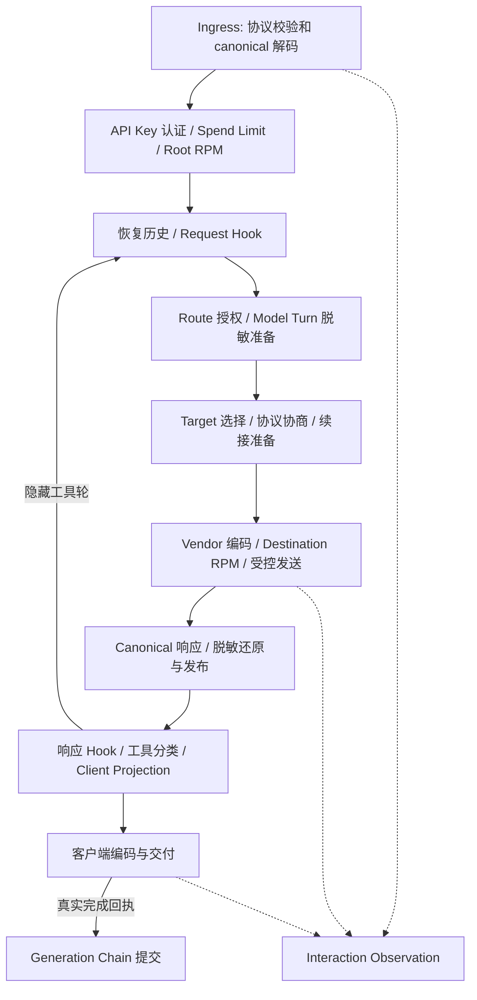

# Stravia 系统架构

Stravia 是面向 AI 编程客户端与智能体应用的本地运行、自托管 Agent 基础设施。
客户端沿用受支持的协议，设置 Gateway 端点、Stravia API Key 和 Route ID；Gateway 负责授权、选路、协议转换与模型执行。
平台还提供工具和内置 Agent，以及独立的历史、用量与诊断视图。自托管不代表所有数据留在本地：模型和外部工具仍会访问配置的上游。

## 部署形态与模块

| 形态 | 宿主 | 适用场景 |
| --- | --- | --- |
| Desktop | Tauri v2，复用本地 HTTP application；原生 IPC 提供端口发现和本地管理会话 | Windows、Linux、macOS 本地运行 |
| Server | 独立 Rust 进程，一个 listener 提供 Proxy、Admin API、健康探针与内嵌 WebUI | 自托管、团队共享 |

`stravia-core` 不绑定 listener。两种宿主共用 `stravia-server` 的 HTTP 组装和 `AdminService`；WebUI 通过管理 HTTP 接口读取和修改实例状态。
管理入口、原生会话与初始化见[管理认证与启动](admin-auth-bootstrap.md)。

| 模块或 crate | 职责 |
| --- | --- |
| `stravia-core` | Gateway、推理生命周期、HookRuntime、路由与准入、管理业务、持久化编排 |
| `stravia-runtime-contract` / `stravia-protocol-codec` | Canonical IR 和共享运行时类型 / 标准协议编解码 |
| `stravia-vendor-sdk` / Core `plugin` | Vendor guest 契约 / 组件装载、受控宿主能力与结果发布 |
| `stravia-sql` | 统一池、连接与事务执行边界，复用 SQLx 驱动 |
| `stravia-credential-protection` | 模型文本的本地[可逆脱敏](credential-protection.md) |
| `stravia-media` / `stravia-web-search` | [媒体理解](media-understanding.md)与[联网搜索](web-search.md)的业务能力 |
| `stravia-web-access` / `stravia-web-access-contract` | 公共资源读取与外部 [Web Provider](web-access-providers.md) 契约 |
| `stravia-server` / `stravia-desktop` / `stravia-webui` | HTTP transport、桌面原生集成与共用管理界面 |

需要 SQL 表、索引、存储与派生缓存时，查[数据布局](data-layout-performance.md)及生成的 [SQLite](../database/sqlite.sql) / [PostgreSQL](../database/postgres.sql) schema。
关闭宿主时先停止新请求并取消 Gateway 后台任务，再排空 HTTP，最后关闭观测与缓存；手动同步可能在等待同一后台任务，不能等 HTTP 排空后才请求取消。

## 请求执行链路



1. **Ingress** 建立 `RequestContext`，保存请求身份、取消、截止时间和入口协议。各协议薄壳先解码、校验并建立观测入口；拒绝可以在 Run 创建之前发生。
2. **Inference Run** 是一次性入口 `inference_run::execute(RunInput)` 的生命周期所有者。先建立 Principal 并完成根请求准入，再恢复已验证历史、运行 Request Hook，最后按本轮 `model` 做绑定授权。
3. **Model Turn Executor** 接收已授权的 Route 或能力授权；在正式模型发送前准备凭据替换，按路由策略选 Target，固定组件及连接快照并协商协议。选定 Target 后才能准备该目的地的上游续接。
4. **Vendor** 将 canonical 请求编码为目标 wire，由宿主在真实发送时检查 Destination RPM。模型结果解码成 `AiResponse` / `AiStreamDelta`，Executor 保留真实上游结果事实，再还原文本、参数并完成映射发布。
5. **Client Projection** 运行响应 Hook，分类工具所有权，处理隐藏轮次并准备公开结果。纯平台工具可在同一客户端 stream 内续跑，不外发中间终态；混合轮次只交付公开调用，后续请求须提交该轮等待的全部客户端工具结果才能续接。
6. **Delivery** 只有实际确认完整交付后才提交 Generation Chain、完成已领取的工具续接；提前断线或交付失败释放领取，不伪造成功回执。平台工具的执行和持久交接归[内置 Agent 与工具](agent-core.md#工具执行交接)。

上游接受请求、Executor 提交 canonical 输出、`Client Output Commit` 和客户端完整交付是不同边界。
Executor 只在首个 canonical 输出前按策略恢复或切换 Target；客户端提交后不更改已发送的状态，也不把失败流当作成功历史。
HTTP buffered 的回执以完整 body EOF 为准，流式 HTTP 与 WebSocket 以各自实际终态交付边界为准。

Generation Chain 保存不可变的已交付历史，Interaction Observation 保存独立的执行诊断投影；二者不属于 Hook，也不互相替代。
诊断缺口、终态与 Debug 见[交互观察](interaction-observation.md)，持久化与提交在[数据布局](data-layout-performance.md)，Responses 协议投影在 [Open Responses](open-responses.md)。
管理 API、健康探针与模型目录等非推理入口不创建 Hook 会话。

## 协议转换

### 协议对与所有权

[ADR-0006](../adr/0006-own-protocol-conversion-behind-canonical-stages.md) 定义 pair-bound 转换：
`ProtocolRegistry` 提供 endpoint 身份、能力、别名与入口路由；协商按 Exact → Same-family → Provider Default 查找合格 egress。
`ProtocolTransform::bind(ingress, egress)` 固定方向；`ProtocolPair` 组合入口与出口的 adapter，不为每对协议维护独立转换器。
状态流的 decoder / encoder 也由同一协议对确定。即使 ingress 与 egress 一致，也没有 raw body、raw stream 或绕过 HookRuntime 的路径。

| 标准协议族 | 入口 endpoint 身份 |
| --- | --- |
| OpenAI-compatible Chat | `openai-compatible/chat-completions/v1` |
| Open Responses | `open-responses/responses/2026-04-24` |
| Anthropic Messages | `anthropic-messages/messages/2023-06-01` |
| Google Gemini | `google-gemini/generate-content/v1beta` |

Codec 拥有单一协议的解码、编码、流式状态和语义投影，不负责路由或认证。
编码前按目标能力形成一次性视图，只省略目标不能承载的部分，不改写共享历史；具体[表达能力规则](open-responses.md#表达能力与省略规则)与真实错误独立。
目标编码器不以来源协议名猜测历史边界，不把未知字段或协议扩展当成通用透传许可。

所有模型 Vendor 均经 `Gateway` 的统一 Wasm 执行入口调用已装载组件。组件 descriptor 决定 profile、channel 与能力；guest 拥有私有 wire、认证和请求构造，宿主控制网络、状态、调度及版本发布围栏。未知身份或 channel 不回退原生实现，私有协议的投影由所属 guest 负责。详见 [Vendor 插件](vendor-plugins.md)。

### Canonical IR

[运行时协议类型](../../backend/crates/stravia-runtime-contract/src/protocol/ir/) 用 `AiRequest`、`AiResponse` 和 `AiStreamDelta` 表示输入、完成事实与增量。
保留有序 item、内容块、结构化思考、工具调用及结果关联、用量和错误；wire 索引、连接帧与认证头不进入语义模型。

- **每个语义只有一个控制位置。** `generation`、`reasoning`、`tools` 等保留各自归属，`AiRequest.parameters` 统一其余请求控制；同义 wire 字段在入口合并，不同时保留可写副本。见 [ADR-0081](../adr/0081-unify-request-controls-without-vendor-parameters.md)。
- **缺省不是显式值。** `false`、`0`、空集合均保留；显式清除通过 `ParameterReset` 阻止父配置继承，目标编码不发送通用 null 占位。
- **会话、关联与缓存分开。** `session.id` 可用于会话亲和；`session.request_id` 仅关联请求；`cache.key` 是 prompt 分桶键，不能替代会话身份或续接证明。模型原生身份由选定 Vendor 从宿主派生的 operation metadata 构造。
- **请求控制与业务对象分开。** 目标 body 和 header 以正向声明投影；业务 metadata、工具 schema、入参与结果中的任意对象键不按请求控制名单递归删除。已消费的入口会话头及凭据不进入通用转发集合。
- **保留响应事实。** 将完整 `AiResponse` 追加为历史时，宿主保存可信响应归属，不靠上游 ID、相邻 item 或角色推断。Chat 只把同一响应的可表示思考、正文和并行调用投影为一条 assistant，不抽走中间正文或重排工具结果。
- **不制造证据。** 缺失用量不补零；工具关联、签名与密文按真实载体处理。解码、权限、网络、实际协议违例不会转成兼容性省略。

Rust 请求 encoder 消费 `AiRequest`，在可唯一拥有时移动正文和已拥有的 JSON 子树；共享历史只在被改写时复制。
原生字段保真不会授权任意参数注入。输出上限缺省通常不补值；协议要求必填时由 codec 使用该协议及目标模型的明确规则，不从上下文窗口推算。

## HookRuntime

### 作用域与生命周期

`GatewayBuilder` 显式注册有序的 Hook 和 `PlatformTool`，构建时校验 ID；运行时不做全局发现或动态切换。
Hook 是受信的进程内工厂；每个 Inference Run 创建独立可变的 `HookSession`，按构建顺序串行运行。
[共享 Hook 契约](../../backend/crates/stravia-runtime-contract/src/hook/)和[宿主 Runtime](../../backend/crates/stravia-core/src/hook/runtime/)分别拥有类型和运行裁决。

Run 覆盖初始 round、纯平台工具隐藏轮次，以及有效混合工具 continuation 的恢复。Target 重试复用本轮已准备请求，不重复执行本轮 Hook。
SessionContext 只给稳定的入口、请求、传输和脱敏主体身份；选路后事件才能读取路由信息。Hook 不获得 raw wire、原始认证头、Provider 凭据或任意存储访问。

| 事件 | 时点 | 可处理内容 |
| --- | --- | --- |
| `Request` | 初始与隐藏 round，路由选择前 | 当前 canonical 请求、上下文区间、已注册工具、本地响应或拒绝 |
| `UpstreamResponse` | 上游响应成为 canonical 结果后 | 允许的内容、思考、客户端工具参数 |
| `ToolResult` | 平台工具完成后、追加回模型前 | 工具结果内容、错误标记和 metadata |
| `ClientOutput` | 隐藏轮处理完成、公开编码前 | 最终客户端可见响应的允许字段 |
| `StreamTransformer` | canonical 流增量到达时 | 正文、思考与客户端工具参数的语义增量 |

### 上下文与动作

`ContextCompleteness::Full` 表示当前历史完整可见；不透明引用使之变为 `Partial`，声明必须观察完整历史的 Hook 跳过并记录 `HookSkip`。
只在存在可执行的 Request 订阅者时构造 `ContextSnapshot`；原始与当前视图在修改前共享不可变数据。
`input_start` 是宿主从可信执行历史恢复的处理边界，不等同于客户端 delta，也不接受客户端自报。
Hook 可以读完整上下文，但普通新输入变换限于未处理后缀；上一轮模型输出第一次成为输入时仍须处理，权限与路由决策也不能缓存为历史处理结果。

- `PatchRequest` 可修改语义字段、路由模型及控制，不可修改主体、认证、目标连接或凭据。`SpliceInput` 相对未处理后缀；历史改写须显式使用 `ReplaceContextSpans`，使被改写区间的旧证明失效。
- `ExposeTool(ToolId)` 只暴露注册表里的稳定工具，不按显示名取得调用所有权。能力门禁和透明注入由[平台能力配置](agent-core.md#平台能力门禁与透明注入)裁决。
- 响应和工具结果 patch 不可改写 usage、stop/lifecycle、工具 ID 或所有权；同一次调用中的后继 Hook 只看到已经应用成功的前序结果。
- 动作批次先校验再原子应用。非法动作、Hook 错误、创建 session 的 panic 或运行时状态错误均失败关闭；不把未完整应用的结果送上游。
- `Respond` 只允许在 `Request`；`Reject` 限于尚未提交输出的 `Request` / `UpstreamResponse`。提交后只能终止当前流，不能改为新的 HTTP 错误。Hook 无单独默认计时，必须响应请求取消。

### 流式约束

Transformer 在客户端每条 response leg 上有独立状态，可 `Pass`、`Emit`、`Hold`、`Replace` 或 `Drop` 允许的语义增量。
Core 保留生命周期、用量、`Done`、`StreamError` 与工具所有权，transformer 不可伪造结构性事件。
每个 session 的缓冲字节与延迟事件有 descriptor 上限，越界失败；正常结束、错误、取消和 drop 都必须完成该 leg 的关闭收口。
隐藏回合可共用一条对客流，只输出合法的最终终止序列；混合续接不把旧 HTTP / WebSocket leg 的缓冲带到下一 leg。

## 路由与访问控制

### Route 与 Target

Route 是客户端 `model` 的大小写敏感入口；Route ID 与用于绑定的内部 `RouteKey` 不同。
Route 用途限定入口：

| Purpose | 用途 |
| --- | --- |
| `chat` | 模型生成；独立 Responses V2 Compact 也须通过兼容入口和目标准入 |
| `image_generation` | [媒体生成](media-generation.md#route-与-provider-接入)的专用 Route |
| `web_search` | [外部联网搜索](web-search.md)的专用 Route |

一个 Route 包含多个 Target，每个 Target 指向已保存 Provider 和一个非空上游模型。
Target 保存启用状态、signed i32 Priority、First Token Timeout、Retry Budget、Cooldown 和 Thinking Level Map。
禁用 Target 可保留在 Route 中，但不参与常规选择、亲和或组内调度；Target 集合原子保存，省略 `targets` 的更新不替换集合。

### 分层选路

资格先于偏好：检查 Route、Target、Provider、模型状态与能力，并排除凭据失效、额度暂停或不合格的冷却目标。
只有全部已启用 Target 仅因额度暂停不可选时返回 `allowance_suspended`（429，无 `Retry-After`），不会把暂停计为 Target 失败。
额度守护依据成功、当前的账号级 Allowance 读取；没有可靠读取不擅自解除暂停，见 [ADR-0078](../adr/0078-suspend-provider-routing-on-guarded-allowance-exhaustion.md)。

1. **Target Continuation** 优先使用已证明的 Target，但不绕过目标健康、授权或发送门禁。Responses 判定见[续接契约](open-responses.md#target-continuation)。
2. **Conversation Affinity** 偏好已建立会话对应的合格 Target。
3. **Cache Affinity** 只在没有对话身份时参与。按 Principal、Route 和语义控制查有界记录，再匹配最长 canonical item Hash 前缀；同长度优先最近成功。仅成功且已报告 `prompt_tokens >= 20,000` 时登记，最多留 24 小时；记录不存正文，可提前淘汰。
4. **Priority lane** 按数值由高到低选组。同组内按下述 Route Scheduling 策略选择；不为了均衡负载抢占仍合格的亲和目标。

| 组内策略 | 决策 |
| --- | --- |
| Traffic Equalization | 先比较实时在途数，再比较近一小时加权 Token 流量与在途输入占位；仍相同则最久未选者优先 |
| Latency Preference | 至少两个 Target 各有 20 个近期成功样本才比较近一小时成功率与输出 Token 速度；否则使用 Traffic Equalization |

选择和预留在同一个状态锁中完成；成功、失败切换和取消释放预留。
历史读取失败可使用最后可信快照并标记 stale；缺少可信历史时仍用实时负载，不让诊断故障阻断选路。
思考档位在选定 Target 后才映射，每个 failover 从原请求档位重新解析；词义与目标映射见 [Thinking Level Map](vendor-plugins.md#自定义协议与思考等级映射)。

### 重试、冷却与超时

- 默认 `Target Retry Budget = 5`：同一 `(provider_id, upstream model)` 第六次连续健康相关失败进入冷却，默认 120 秒。完整成功清零；本地准备、Hook、存储、取消与客户端断线不计数。
- 瞬时上游失败按策略做指数退避同 Target 重试（3 秒起，加抖动，最多 60 秒）；非瞬时的目标级认证、授权、额度或上游请求失败通常切换。明确的上下文超限、内容过滤等请求级错误终止请求。
- `First Token Timeout` 默认 120 秒，0 关闭。只用于普通流式生成，是首个有效输出前的上游空闲窗口，而不是端到端时限。窗口每次在 95%–105% 浮动；本次 attempt 的上游数据或心跳重置，正文、思考或工具调用的首个有效输出解除计时。本地保活不续期。
- 非流式生成和独立 **Responses V2 Compact** 沿用共享空闲 deadline（默认 300 秒）及取消；即使压缩由 SSE 交付也不采用 First Token Timeout。独立 Compact 不参与普通推理重试或故障转移。
- 上游明确 `Retry-After` 位于启用的 First Token Timeout 基准值以内时，若余量和重试资格允许，同 Target 等满再重发；基准值为 0 时不加这项时长上限。等待不小于剩余 deadline 时改选合格备用，无备用返回原上游错误。
- 超过启用的基准值时立即改选，原 Target 冷却 `min(target_cooldown_ms, Retry-After)`。冷却为 0 仍跳过本次 Target，不建共享等待；不把共享门禁延长到原始长 `Retry-After`。
- 冷却结束不主动探测；下一次实际选中只原子发放一个半开名额。半开无额外预算重试，真实上游失败重新冷却；本地失败或取消只释放名额。明确未执行的续接恢复仍受其单次契约限制。

共享失败计数、冷却、半开和运行预留仅存在于一个 Gateway 进程，重启不从诊断历史恢复；持久的禁用、凭据失效或额度暂停不因此解除。
具体选路层次见 [ADR-0034](../adr/0034-layer-route-target-selection.md)。

### API Key 与 Root RPM

API Key 与 Route 独立管理、多对多绑定。通用推理认证识别 Bearer、`x-api-key` 和 `x-goog-api-key`；协议入口可更严格，Open Responses 与 MCP 要求 Bearer。
缺失、无效或过期凭据不准入；撤销与无模型绑定按各自授权错误返回。模型列表只展示有效 Key 已绑定的可见 Route。

认证后先检查 [Spend Limit](cost-and-billing.md)，然后在 Request Hook 前扣一次 Root RPM；最终模型的绑定授权在 Hook 后执行，避免 Hook 改名跨越权限。
Proxy 推理（含 **Responses V2 Compact**）和 MCP `tools/call` 共用该 Key 窗口；发现、工具列表与 WebSocket upgrade 不计数。
内部轮次、重试、切换与工具共享 `RootRequest`；独立客户端续接或重发各计新根。

窗口按单调时钟取 `(t − 60s, t]`。`rpm_limit` 为正整数或 `null`（不限）；超限立即返回 429（`STRAVIA_RPM_LIMIT`）和向上取整的 `Retry-After`，不排队、不执行 Hook。
成功、失败或取消不退回已计记录。活跃流、chunk 与心跳不单独计数，已满 60 秒的记录离窗。
配置持久化，计数只在当前进程共享；这不是并发限制，也不协调多个实例。

### Destination RPM

目的地限额按 `(provider_id, upstream model)` 跨 Route 计数；不同目的地没有共享池。
每次真实模型 HTTP 请求或 WebSocket 逻辑请求发送前，宿主重新检查额度、当前资格、deadline 和取消。包括同 Target 重试、failover、隐藏轮次和获准的续接重发。
本地准备、握手／连接复用、心跳与 chunk 不用独立额度；已发出的失败不退额度。

| 等待边界 | 缺省 |
| --- | --- |
| 原 Target 有亲和或同根选择依据时的优先等待 | 5 秒 |
| 同一 RootRequest 跨轮次与目的地共享累计等待 | 30 秒，受实际 deadline 限制 |
| 每实例等待队列 | 128 个根，不是活跃流并发上限 |

管理设置 `/api/v1/settings/rpm_admission` 拥有等待边界；单模型 RPM 在 Provider 模型目录或详情独立编辑，不提交规格草稿也不修改 Route。
等待结束重新查询并原子竞争，不沿用旧配额快照跨越绑定或禁用变更。等待耗尽为 `target_rpm_exceeded`（429）；队列满为 `target_rpm_queue_full`（503）。

## Provider Catalog 与 Provider Model

### 目录刷新与连接

[ADR-0018](../adr/0018-use-revisioned-stravia-model-catalog.md) 固定远端 `https://models.stravia.cn`：
`/version.json` 是 revision gate，`/providers.json` 与 `/models.json` 是轻量索引，`/providers/{provider_id}/models.json` 按需加载。
启动先读内嵌索引；运行后每小时或手动刷新，两份全局索引校验完成且 revision 复核一致才切换 active generation。
失败继续使用完整的 last-known-good generation。Provider scope 由 `(revision, provider_id)` 隔离，不能以旧 scope 冒充当前 revision。

创建连接时固定 Catalog 身份和 channel，解析协议、Base URL 与认证；变更 channel 须重建连接。OAuth 可使模型来源变成账号作用域的动态 discovery。
动态 discovery 决定库存成员；目录只为同一上游 ID 富化规格，不能把仅在目录存在的型号加入账号库存。
富化失败保留有效来源和管理员固定字段，已确认库存仍可提交；失败或不完整的账号发现不替代上次库存。

### 规格快照与单字段固定

规格快照归已保存的 Provider 实例与上游模型 ID。状态区分未登记、带来源的导入规格及无来源的本地规格；一次性 Canonical Model 模板不建立实时继承关系。
来源刷新只覆盖未固定字段；编辑 `null` 表示取消登记并固定，不表示恢复同步。恢复同步使用最后有效来源快照，无须重新抓取目录。

读视图不把缺失上下文或 effort 伪造为值；缺省模态只在有效规格投影中回落到 text input/output，不回写快照，显式空列表保持为空。
`SelectionPolicy`（`auto` / `force_enabled` / `force_disabled`）与发现状态和生命周期共同确定可用性，影响新绑定及后续发送；不自动删除已有 Target，也不覆盖 Provider 禁用或凭据限制。

编辑通过 revision 防止并发覆盖。更新规格、成本规则、配置 epoch 与受影响 Target 的 Generated Mapping 在同一个事务提交；显式 Overridden 行不改写。
跨实例配置刷新是异步的，Redis 不提供配置发布协议。价格字段与计费逻辑见[成本与计费](cost-and-billing.md)。

### 模型变更记录

符合条件的 Provider 默认启动即检查，此后每小时检查；同 Provider 的自动与手动同步合并。发现预算为每个 Provider 60 秒，含凭据准备、分页与等待 Vendor 发布围栏；不按页或加入者重计。
禁用、凭据失效或插件能力不可用时暂停自动检查；手动检查不受自动偏好限制，但仍受执行资格约束。后台任务不依赖浏览器或窗口存活。

Model Change Record 保存已确认的库存、生命周期和规格差异，以及手动新增或 Selection Policy 改动；不从当前快照重建历史。成功但无变化只更新检查摘要；失败不清空库存，提交后的局部失败可标记 `partial_success`。
记录可按 Provider、类型、来源及搜索词分页查看，保留 90 天。Provider 改名或删除不改变记录身份；同名重建不合并历史。

## 共享出站代理配置

`outbound_proxy` 一次读写完整快照：`url`、`bypass`、`force_http1`。空 URL 表示尚未配置，非空只接受 `http`、`https`、`socks5` 或 `socks5h`。
非法配置不改写旧值，错误不回显敏感 URL；保存不探测代理在线或认证成功。

| 消费者 | 独立选择 |
| --- | --- |
| 模型 Provider | 连接的 `use_proxy`；关闭明确直连，开启须有合法共享配置 |
| Web Provider | 自己的 `use_proxy` 与适配器支持策略，见 [Web Provider](web-access-providers.md) |
| 产品更新 | `update_use_proxy`（默认关闭），用于 release/manifest 和 Desktop 更新检查、下载 |

逗号分隔的 `bypass` 匹配主机、IP 或域后缀，匹配则直连，不用进程全局 `NO_PROXY`；绕过代理不改变权限与地址校验。
`force_http1` 只影响 Vendor HTTP，不改变 WebSocket、Web Access 或更新协商；Provider Catalog 与 S3 不受这组选择控制。
配置变更用于后续操作，在途连接不重新路由。Vendor 出站传输实现见 [WIT 与受控网络](vendor-plugins.md#wit-契约与受控出站网络)。

## Nix Server 与 NixOS 服务

启用 Nix 的 `nix-command` 与 `flakes` 后，在仓库根目录构建 Linux Server（`x86_64-linux`、`aarch64-linux`）：

```bash
nix build .#stravia-server
nix run . -- --help
```

Flake 同次构建并嵌入生产 WebUI、翻译和随包官方 Wasm Vendor；普通非 Nix 构建默认只内嵌 `base`。
随包装载及市场或本地覆盖遵循[插件安装生命周期](plugin-marketplace.md)。Flake 不包含 Desktop、开发 shell 或浏览器运行时。

在系统 flake 中增加 `stravia.url = "github:Stravia-AI/StraviaPlatform";` 输入并导入 `stravia.nixosModules.default`。
启用 `services.stravia.enable` 即运行 `stravia.service`；默认以非 root `stravia` 用户监听 `127.0.0.1:23471`，不开放防火墙，持久根是私有的 `/var/lib/stravia`。
初次配置从 `journalctl -u stravia.service -b` 安全获取 Setup Token；`/healthz` 和 `/readyz` 分别检查存活与就绪。

下面以同机 Nginx 为 TLS 入口，只信任实际的回环代理地址，固定外部 authority 并清除客户端传入的 `Forwarded`：

```nix
{
  services.stravia = {
    enable = true;
    adminOrigins = [ "https://stravia.example.com" ];
    trustedProxies = [ "127.0.0.1" ];
  };
  services.nginx = {
    enable = true;
    recommendedProxySettings = false; # 本例显式设置转发头，不叠加预设。
    virtualHosts."stravia.example.com" = {
      enableACME = true;
      forceSSL = true;
      locations."/" = {
        proxyPass = "http://127.0.0.1:23471";
        proxyWebsockets = true;
        extraConfig = ''
          proxy_set_header Host stravia.example.com;
          proxy_set_header X-Forwarded-Host stravia.example.com;
          proxy_set_header X-Forwarded-Proto https;
          proxy_set_header Forwarded "";
          proxy_buffering off;
        '';
      };
    };
  };
}
```

证书、DNS 与 Nginx 的防火墙由部署者负责；模块的 `openFirewall` 不改变监听地址、不生成 TLS，也不应为此代理场景打开 Stravia 的后端端口。
`configFile` 是应用可原子替换的绝对运行时路径，不可指向 Nix store；应用自己持有数据库与 Redis 配置。
完整选项与默认值见 [NixOS module](../../nix/nixos-module.nix)，信任边界见[管理入口与代理信任](admin-auth-bootstrap.md#管理入口与代理信任)。

## 开发环境与 patch-crate

Linux 开发可在根目录运行 `devenv shell`，工具链以 `devenv.nix`、`rust-toolchain.toml` 和 `package.json` 为准。
使用 direnv 时先审阅 `.envrc` 再 `direnv allow`。进入环境不会自动安装工作区依赖或启动服务；开发入口见 [Taskfile](../../Taskfile.yml)。
跨 worktree 预热只补齐缺少的目录；本地状态可能含凭据，复制前停止源实例和构建，不把 reflink 文件复制视为在线数据库备份，也不假定外部 PostgreSQL/Redis 已隔离。

直接运行 Cargo 前执行：

```bash
task prepare:crates
```

该任务按需安装固定的 `patch-crate 0.1.13`（devenv 与 Nix 打包共用[工具定义](../../nix/patch-crate.nix)），从根 Cargo metadata 与 `patches/<crate>+<version>.patch` 生成 `target/patch/` 下的源码，由 `patch.crates-io` 引用。
清理 `target` 后必须重新准备；升级 crate 须同步精确版本、patch、根 metadata、Cargo path 与 Task 产物路径，不提交生成源码。
需要强制刷新时先停止构建，再运行 `task --force prepare:crates`；准备失败不得继续构建。
离线准备须预装工具并提供完整 Cargo 目录源，包括被 path patch 替换的原始 crate，不能只依赖已缓存的归档或 `CARGO_NET_OFFLINE`。
