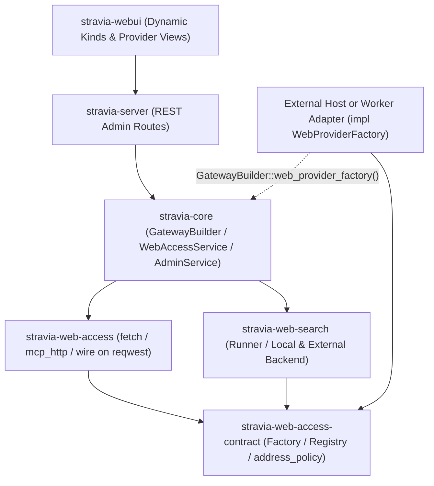

# Web Access Provider 外部化与解耦重构设计

> 状态：已实施
> 更新：2026-11-22
> 相关文档：[系统架构设计](architecture.md)、[Web Search 设计](web-search.md)、[Vendor 插件设计](vendor-plugins.md)
> 历史决策上下文：[ADR-0002](../adr/0002-web-access-provider-seam.md)、[ADR-0024](../adr/0024-local-web-provider-in-process-metasearch.md)、[ADR-0025](../adr/0025-in-process-web-fetch-quality-gate-chromium.md)、[ADR-0026](../adr/0026-local-web-outbound-proxy-mode.md)、[ADR-0031](../adr/0031-own-web-access-adapters-in-stravia-web-access.md)

## 1. 背景与重构目标

### 1.1 原架构问题

在重构前，`stravia-web-access` 与 `stravia-core` 在编译期和运行期均深度绑定三类硬编码 Web Provider（`local`、`exa`、`zhipu`）及本地 Chromium 运行时，带来四类结构性耦合：

1. **重依赖与运行时膨胀**：`stravia-web-access` 内嵌 `wreq`/`wreq-util`、CDP 浏览器控制、隐身注入脚本以及 `fend-core`/`numbat`/`maud`/`ammonia` 等计算与页面处理依赖；Docker 镜像被迫内置 Chromium 与字体，NixOS 模块需维护 `browserPackage` 与 `STRAVIA_CHROME_PATH`。
2. **协议与核心层硬编码枚举**：数据库表 `web_providers` 固化了 `kind IN ('local', 'exa', 'zhipu')`、`local_engines` 专用列以及 `idx_web_providers_local_singleton` 局部唯一索引；`stravia-core` 内建 `admin/browser.rs` 路径探测与管理 API `/api/v1/web-access/browser`；WebUI 硬编码引擎选项列表与浏览器路径选择器。
3. **测试与扩展走旁路**：核心测试依赖私有 `AdapterFactory` 替身绕过真实装配链路，外层宿主无法通过标准扩展缝注入新的搜索引擎、抓取服务或独立执行节点（Worker）。
4. **演进边界不清**：开源核心承担了应归属独立运行时或外部执行节点的浏览器抓取与反爬逻辑，导致核心安全边界与分发形态过重。

### 1.2 重构目标

- **彻底剥离内置适配器与浏览器运行时**：从开源仓库移除 `LocalWeb`、Chromium/CDP 进程管理、内置搜索/抓取引擎及硬编码的 `exa`/`zhipu` 适配器，移除相关构建与部署依赖。
- **建立标准编译期注入缝**：在 `stravia-web-access-contract` 定义 `WebProviderFactory` 与 `WebProviderRegistry`，在 `GatewayBuilder` 提供 `.web_provider_factory(...)` 注入入口，使外层宿主在不修改 `stravia-core` 的前提下接入任意外部 Web Provider（如独立 Worker 适配器或第三方搜索服务）。
- **泛化存储、管理面与前端发现**：数据库将 `local_engines` 泛化为通用 `config_json` 并解除 `kind` 枚举限制；管理端新增 `GET /api/v1/web-provider-kinds` 与脱敏 `WebProviderView`；WebUI 完全数据驱动，支持零注册类型的克制空状态及遗留未注册记录的安全展示与清理。
- **保留公共工具与安全基线**：保留公开地址静态策略（`address_policy`）、安全重定向解析（`resolve_final_url`）、网页字节解码与正文提取（`convert_read_bytes`、`resource`）、远程 MCP Streamable HTTP 传输（`mcp_http_transport`）及 wire-debug 抓包封装（`wire`）。

### 1.3 非目标

- 不改变公开 `StraviaRead` 协议、`stravia://search` 语义及 `WebSearchBackend` 的 `local` / `external` 二元概念。
- 不改动 Wasm Vendor 插件提供的外部完整搜索路由（Codex / Antigravity / DeepSeek 等通过 `Capability::Search` 提供的 External Search Route 继续正常工作）。
- 不将 Web Provider 塞入 Wasm Vendor 插件机制（浏览器/外部 Worker 调度与 Wasm 推理编解码属于正交运行边界）。
- 不在升级迁移中删除用户历史配置的非 `local` Provider 记录及其凭据。

## 2. 架构与模块边界

### 2.1 重构后依赖关系



### 2.2 模块职责划分

| 模块 | 重构后职责 | 明确移除项 |
|---|---|---|
| `stravia-web-access-contract` | 定义 `WebProviderAdapter`、`WebProviderFactory`、`WebProviderRegistry`、`WebProviderKindDescriptor`、`WebProviderCapabilities`、`WebProviderConfig`、`OutboundProxyMode` 及静态地址规则 `address_policy` | 无运行时实现或网络客户端依赖 |
| `stravia-web-access` | 提供基于 `reqwest` 的 `fetch::{convert_read_bytes, resolve_final_url, resource}`、`mcp_http::mcp_http_transport` 与 `wire::{Exchange, send, stream, body}`，并重导出契约 crate | 移除 `local.rs`、`remote.rs`、`browser/`、`search/`、`http_client.rs`、`outbound.rs`、`fetch/http.rs`、`config-default.toml`、`examples/` 及 `wreq`/`wreq-util`/`fend-core`/`numbat`/`maud`/`ammonia` |
| `stravia-core` | 通过 `GatewayBuilder::web_provider_factory` 冻结 `Arc<WebProviderRegistry>`；`AdminService`、`WebAccessService`、`WebSearchHost` 与 SQLite/PostgreSQL 存储层完全面向注册表与通用 `config_json` 运行 | 移除 `admin/browser.rs`、`LocalSearchEngine*` 类型、`Gateway::{browser_path, set_browser_path}`、旧测试 `AdapterFactory` 旁路与硬编码 `local`/`exa`/`zhipu` 分支 |
| `stravia-server` | 暴露 `GET /api/v1/web-provider-kinds`；`/api/v1/web-providers*` 统一返回脱敏 `WebProviderView`；`PUT /api/v1/web-access/settings` 统一透传结构化错误码 | 移除 `GET/PUT /api/v1/web-access/browser` 路由及 `web_provider_value` 专用序列化器 |
| `frontend/stravia-webui` | 消费 `/web-provider-kinds` 与 `WebProviderView`；按 `descriptor` 动态控制表单、空状态、未安装遗留项与可用性门控 | 移除浏览器路径编辑、Tauri 浏览器文件选择器、`LocalSearchEngine*` 表单项、`WEB_ACCESS_BROWSER_REQUIRED` 与三枚举硬编码 |
| 部署与打包（Docker / NixOS） | 仅打包基础 TLS 根证书与服务端二进制，保持零浏览器运行时依赖 | 移除 Dockerfile 中 Chromium/字体及 `STRAVIA_CHROME_PATH`；移除 NixOS `services.stravia.browserPackage` 与相关冲突检查/VM 冒烟用例 |

### 2.3 拆出代码归档与许可保留

被移除的 `stravia-web-access` 原始实现（含 MIT 许可归属的 stealth 脚本与原 `LICENSE`）及相关核心/前端参考快照在重构前已独立归档，不保留在开源仓库工作树中。后续在独立仓库或外部执行节点中复用时，须保留对应的 MIT 许可声明，并通过本文第 3 节定义的 `WebProviderFactory` 契约接入。

## 3. 核心扩展缝设计（Rust 契约与装配）

### 3.1 `stravia-web-access-contract::factory` 契约

核心通过以下最小且封闭的数据模型与 trait 屏蔽具体适配器实现：

```rust
#[derive(Debug, Clone, PartialEq, Eq)]
pub enum OutboundProxyMode {
    Direct,
    System,
    Explicit { url: String, bypass: String },
}

#[derive(Debug, Clone, Copy, Serialize, Deserialize, PartialEq, Eq)]
pub struct WebProviderCapabilities {
    pub search: bool,
    pub fetch: bool,
}

#[derive(Debug, Clone, Serialize, Deserialize, PartialEq, Eq)]
pub struct WebProviderKindDescriptor {
    pub kind: String,
    pub capabilities: WebProviderCapabilities,
    pub requires_api_key: bool,
    pub singleton: bool,
    pub allow_delete: bool,
}

#[derive(Debug, Clone)]
pub struct WebProviderConfig {
    pub id: String,
    pub name: String,
    pub kind: String,
    pub api_key: Option<String>,
    pub use_proxy: bool,
    pub config_json: Option<Value>,
}
```

`WebProviderFactory` 定义了管理期校验、敏感脱敏、健康探测与运行期构造的完整生命周期：

| 方法 | 调用时机 | 默认行为与约束 |
|---|---|---|
| `descriptor(&self) -> WebProviderKindDescriptor` | 注册、列表查询、CRUD 门控 | 必填；`kind` 必须为非空小写标识符（首尾无空白），`WebProviderRegistry::register` 拒绝非法值或重复注册 |
| `validate_config(&self, api_key, api_key_supplied, config_supplied, config_json: Option<&mut Value>) -> Result<(), String>` | 创建与更新保存前 | 默认按 `descriptor.requires_api_key` 校验：需要密钥时要求非空白，不需要时若显式传入 `api_key` 则报错；实现方可在校验同时规范化 `config_json`，但核心会再次校验结果必须为 `None` 或 JSON 对象 |
| `merge_config(&self, current, update) -> Value` | 更新传入 `config: Some(obj)` 时 | 默认整对象替换；需要保留私有子字段（如加密 Cookie/Token）的工厂可在此实现局部合并 |
| `default_config(&self) -> Option<Value>` | 创建未提供 `config` 时 | 默认返回 `None`；有默认对象配置的工厂可返回初始 JSON 对象 |
| `public_config_view(&self, config) -> Option<Value>` | 构造 `WebProviderView` 返回管理 API 时 | 默认返回 `None`（安全默认：不回显任何原始配置）；仅在明确剔除敏感字段后返回可展示子集 |
| `async fn is_available(&self) -> bool` | 视图投影、设置启用校验、运行期解析 | 默认返回 `true`；用于反映运行期依赖（如外部 Worker 连通性、许可或前置环境）是否就绪 |
| `unavailable_reason(&self) -> (&'static str, String)` | `is_available()` 返回 `false` 时 | 默认返回 `("WEB_PROVIDER_UNAVAILABLE", "...")`，同时驱动视图文案与设置保存拒绝错误码 |
| `build(&self, config, outbound) -> Result<Arc<dyn WebProviderAdapter>, ProviderFailure>` | 单次连接测试或运行期执行快照 | 根据持久化记录与已解析的 `OutboundProxyMode` 构造可执行适配器；不得在构造外隐式读取进程全局代理 |

### 3.2 `GatewayBuilder` 装配与运行期执行流

1. **启动期装配**：外层宿主通过 `GatewayBuilder::web_provider_factory(factory: Arc<dyn WebProviderFactory>)` 逐个注册扩展工厂。`GatewayBuilder::build()` 校验并冻结 `WebProviderRegistry` 为 `Arc<WebProviderRegistry>`，写入 `GatewayRuntime`。开源默认构建不调用该方法，注册表为空。
2. **运行期快照解析（`WebAccessService`）**：
   - 每次搜索或网页抓取入口读取当前的 `WebAccessSettings`、全部 `WebProvider` 记录及共享 `outbound_proxy` 快照。
   - 按 `search_provider_ids`（或 `fetch_provider_ids`）顺序遍历已选 ID：若记录不存在、对应 `kind` 未注册、工厂不具备目标能力、或 `factory.is_available().await == false`，则跳过该项并继续下一顺位（不会因单一离线或遗留来源阻塞其他可用来源）。
   - 根据记录的 `use_proxy` 与共享代理快照解析 `OutboundProxyMode`（关闭则 `Direct`；开启则校验共享代理 URL 非空且合法，生成 `Explicit { url, bypass }`，非法时失败关闭不回退直连）。
   - 调用 `factory.build(&WebProviderConfig, outbound)` 构造适配器，沿用既有 `WEB_ACCESS_DEADLINE` 总时限与有序 failover：批量网页抓取仅对失败的 URL 顺延至下一个可用 Provider 重试。
3. **测试注入机制**：`stravia-core/src/test_support.rs` 提供 `StubWebProviderFactory`（支持配置 `requires_api_key`、`singleton`、`allow_delete`、动态 `AtomicBool` 可用性开关、按 `provider_id` 绑定测试适配器与记录观测到的 `OutboundProxyMode`），所有 Core 与 Server 测试均经由真实 `GatewayBuilder::web_provider_factory` 路径验证。

## 4. `stravia-web-access` 公共工具层边界

瘦身后的 `stravia-web-access` 专注提供与具体搜索/抓取厂商无关的基础能力，供 `stravia-core` 与 `stravia-web-search` 直接复用：

- **`address_policy`（定义于 `stravia-web-access-contract`，`stravia-web-access` 重导出）**：`allows_url(&Url)` 与 `is_public_ip(IpAddr)` 是静态 HTTP(S) 与 IP 分类规则的唯一所有者，拒绝内网、回环、链路本地、文档段、CGNAT、保留段、带凭据 URL 以及 `localhost`/`.localhost`/`.local`/`home.arpa` 等主机名，并统一去除尾随点后按 IP 复检。
- **`fetch` 模块**：
  - `convert_read_bytes`：统一处理 `raw` 严格解码（按 BOM、Content-Type charset、HTML meta、默认 UTF-8，不支持未知或损坏编码）与有损阅读转换。
  - `resolve_final_url(value, OutboundProxyMode)`：供 `stravia-web-search` 还原 Google grounding 重定向等场景。底层由 `wreq` 迁至 `reqwest`，保留逐跳重定向上限与公开地址校验、直连 DNS 全量校验 + IP pinning + 对端地址复检，以及显式代理下的 `socks5 -> socks5h` 规范化与 `NoProxyList`（IP / CIDR / 域后缀）绕过判定。
  - `resource` 与精简后的 `extract`：保留 HTML 正文提取与 Markdown 转换流水线，移除仅服务于本地渲染回退质量打分的冗余逻辑（`json_markdown`、`xml_markdown`、`is_low_quality`、`score`）。
- **`mcp_http` 模块**：`mcp_http_transport(client, config)` 独立成顶层模块，继续提供远程 MCP 的 Streamable HTTP 传输及事件上限取消保护。
- **`wire` 模块**：公开 `Exchange`、`send`、`stream`、`body`，由调用方显式传入 `wire_debug::current()` 捕获器，使 `reqwest` 抓包与具体 Web Provider 实现完全解耦。

## 5. 数据库 Schema 与迁移 0058 设计

### 5.1 表结构与约束演进（SQLite & PostgreSQL 一致）

| 维度 | 迁移 0058 之前 | 迁移 0058 之后 |
|---|---|---|
| `kind` 约束 | `CHECK (kind IN ('local', 'exa', 'zhipu'))` | `CHECK (length(trim(kind)) > 0)` |
| 专有配置列 | `local_engines`（SQLite `TEXT` / PG `jsonb`） | `config_json`（可空；非空时必须为合法 JSON 对象） |
| `api_key` 约束 | 与 `kind` 耦合的复合凭据约束 | `CHECK (api_key IS NULL OR length(trim(api_key)) > 0)`（是否必填由对应 `WebProviderFactory` 校验） |
| 单例索引 | `idx_web_providers_local_singleton`（仅限 `local`） | 移除数据库硬编码单例索引，改由管理层按 `descriptor.singleton` 动态校验 |
| SQLite 触发器 | `web_providers_boolean_{insert,update}` 校验 `local_engines` | 重建为校验 `use_proxy`、`last_test_success` 布尔整数语义及 `config_json` 为 JSON 对象 |
| 全新安装初始数据 | 预置 `web-provider-local` 行；settings 默认含该 ID | `web_providers` 为空；`web_access_search_provider_ids` 与 `web_access_fetch_provider_ids` 均为 `[]` |

### 5.2 迁移 0058 执行与数据留存策略

配对文件：`backend/crates/stravia-core/migrations/sqlite/0058_generalize_web_providers.sql` 与 `postgres/0058_generalize_web_providers.sql`。

1. **DDL 变更**：
   - PostgreSQL 原地 `DROP CONSTRAINT`、`DROP INDEX`、`ALTER TABLE ... RENAME COLUMN local_engines TO config_json` 并添加三个泛化 `CHECK` 约束。
   - SQLite 通过 `CREATE TABLE web_providers_new` → 拷贝筛选后的行 → `DROP TABLE` → `ALTER TABLE RENAME` 完成表重建，并重建两个 `BEFORE INSERT/UPDATE` 触发器。因 `web_providers` 无任何入站外键，58 已在 `migrations.rs` 显式登记于 `sqlite_migration_keeps_foreign_keys`，全程保持 `PRAGMA foreign_keys = ON`。
2. **遗留数据策略（不删用户配置）**：
   - 仅删除内置默认种子行：`WHERE id = 'web-provider-local' AND kind = 'local'`。
   - 已有 `exa`、`zhipu` 或其他自定义记录完整保留（包括 `api_key`、`use_proxy`、`last_test_*` 与时间字段），避免升级或切换部署形态时丢失用户凭据。
3. **设置数组保序裁剪与清理**：
   - 从 `web_access_search_provider_ids` 与 `web_access_fetch_provider_ids` 中移除 `'web-provider-local'` 并保持剩余项相对顺序不变：SQLite 使用 `json_each` + `ORDER BY key` + `json_group_array`，PostgreSQL 使用 `jsonb_array_elements_text(...) WITH ORDINALITY` + `jsonb_agg(elem ORDER BY ord)`，空集统一回落为 `'[]'`。
   - 删除已废弃的 `settings` 键 `web_access_browser_path`。
4. **事务、性能与启动进度**：
   - 全流程为纯 SQL 集合操作，在单一 SQLx 迁移事务内原子执行；失败自动回滚，重启可幂等重试。
   - `web_providers` 属配置级小表（通常个位数至数十行），迁移耗时毫秒级，复用既有 `schema_migrations` 启动进度阶段，不引入额外进度阶段或翻译键。
5. **参考 Schema**：已通过 `stravia-tools dump-schema` 同步更新 `docs/database/sqlite.sql` 与 `docs/database/postgres.sql`。

## 6. 管理业务规则与 HTTP REST API 契约

### 6.1 端点变更清单

| 方法与路径 | 状态 | 说明 |
|---|---|---|
| `GET /api/v1/web-provider-kinds` | 新增 | 受管理员鉴权保护；返回 `{ "data": WebProviderKindDescriptor[] }`，开源默认返回 `[]` |
| `GET /api/v1/web-access/browser` | 移除 | 不再提供本地浏览器状态探测 |
| `PUT /api/v1/web-access/browser` | 移除 | 不再提供本地浏览器路径配置 |
| `GET /api/v1/web-providers` | 变更 | 返回 `{ "data": WebProviderView[] }`（脱敏视图） |
| `GET /api/v1/web-providers/{id}` | 变更 | 返回 `{ "data": WebProviderView }` |
| `POST /api/v1/web-providers` | 变更 | 接受 `{ name, kind, api_key?, use_proxy?, config? }`，成功返回 `201 Created` 与 `WebProviderView` |
| `PUT /api/v1/web-providers/{id}` | 变更 | 接受 `{ name?, api_key?, use_proxy?, config? }`（`api_key`/`config` 支持双层 `Option` 区分未传与显式清空），返回 `WebProviderView` |
| `DELETE /api/v1/web-providers/{id}` | 变更 | 按 `descriptor.allow_delete` 判定（未注册遗留记录始终允许删除），成功返回 `204 No Content` |
| `POST /api/v1/web-providers/{id}/test` | 保留 | 调用已注册工厂执行连接测试并落盘测试状态；未注册或不可用返回失败结果 |
| `GET / PUT /api/v1/web-access/settings` | 变更 | 读写 `{ search_provider_ids, fetch_provider_ids }`；`PUT` 透传所有带 `code` 的校验错误 |

### 6.2 `WebProviderView` 脱敏契约

持久化模型 `WebProvider` 的 `api_key` 与 `config_json` 均标注 `#[serde(skip_serializing)]`，管理 API 统一序列化 `WebProviderView`：

```json
{
  "id": "wp_01...",
  "name": "Worker Web",
  "kind": "worker-web",
  "api_key_configured": true,
  "use_proxy": false,
  "config": { "endpoint": "https://worker.internal" },
  "capabilities": { "search": true, "fetch": true },
  "registered": true,
  "available": true,
  "allow_delete": true,
  "last_test_success": true,
  "last_test_at": "2026-11-22T02:00:00Z",
  "created_at": "2026-11-22T01:00:00Z",
  "updated_at": "2026-11-22T02:00:00Z"
}
```

当 `provider.kind` 在当前构建中未注册时，视图稳定投影为：

- `registered: false`、`available: false`
- `capabilities: null`、`config` 省略
- `unavailable_reason: "Web Provider kind '<kind>' is not registered in this build"`
- `allow_delete: true`（确保管理员始终可以清理历史遗留记录）

### 6.3 业务不变量与结构化错误码

- **创建**：`kind` 必须已注册；若 `descriptor.singleton == true` 且同 `kind` 记录已存在，拒绝创建；名称去空白且唯一；若未提供 `config` 则取 `factory.default_config()`；校验 `config` 为 JSON 对象并交由 `factory.validate_config(...)` 校验；成功后递增 `config_epoch`。
- **更新**：仅允许更新已注册类型的记录；`config` 更新通过 `factory.merge_config(current, incoming)` 合并后再经 `validate_config` 校验；`api_key` 省略时保持原值，显式传入空串或 `null` 时按清空处理。
- **删除**：已注册且 `descriptor.allow_delete == false` 时拒绝删除；未注册遗留记录无条件允许删除，同时原子清理 `web_access_*_provider_ids` 中的对应引用。
- **优先级设置（`update_web_access_settings`）**：
  - 列表内 ID 不允许重复；
  - 每一项必须存在、对应 `kind` 已注册且具备相应能力（`search` 或 `fetch`）；
  - **非对称可用性门控**：对于**新加入**列表的 ID，要求 `factory.is_available().await == true`，否则拒绝保存并返回工厂提供的错误码与原因；对于**原本已在** `current_ids` 中的 ID，允许在保留原位置不变或取消勾选其他项时继续保存（避免节点临时离线后管理员无法移除或调整配置）。

| 错误码 | HTTP 状态 | 触发条件 |
|---|---|---|
| `WEB_PROVIDER_SINGLETON_CONFLICT` | `400` | 尝试为 `singleton: true` 的类型创建第二条记录 |
| `WEB_PROVIDER_DELETE_FORBIDDEN` | `400` | 尝试删除 `allow_delete: false` 的已注册记录 |
| `WEB_PROVIDER_UNAVAILABLE`（或工厂自定义码） | `400` | 在 `PUT /api/v1/web-access/settings` 中新勾选当前 `is_available() == false` 的来源 |
| `WEB_PROVIDER_NAME_CONFLICT` | `400` | 创建或重命名时与已有 Web Provider 名称冲突 |

## 7. WebUI 动态发现与交互设计

### 7.1 数据流与查询缓存

- `src/lib/admin-client.ts` 新增 `admin.webAccess.kinds.list()`（对应 `GET /api/v1/web-provider-kinds`），删除 `admin.webAccess.browser`。
- `web-access-configuration.svelte` 并行订阅三个查询键：`['web-provider-kinds']`、`['web-providers']`、`['web-access-settings']`。当 `kindsQuery` 加载失败时通过 `RequestFailure` 提供重试，绝不将请求失败误渲染为空状态。
- `routes/vendor-plugins/+page.svelte` 在刷新插件运行时查询时同步失效 `['web-provider-kinds']`。

### 7.2 界面状态矩阵

| 场景 | 条件 | UI 行为 |
|---|---|---|
| 开源默认无扩展 | `kinds.length === 0 && webProviders.length === 0` | 展示克制空状态，说明当前版本未内置或安装 Web Provider 扩展，引导改用 External Search Route；隐藏“添加服务”入口 |
| 未注册遗留记录 | `provider.registered === false` | 展示 destructive「Not installed / 未安装」徽章与 `unavailable_reason`；隐藏/禁用测试、编辑与新勾选启用；若旧配置仍勾选则允许取消勾选，并按 `allow_delete` 保留删除清理能力 |
| 已注册但当前不可用 | `provider.registered === true && !provider.available` | 展示 warning 状态指示与 `unavailable_reason`；禁止新勾选启用，允许取消勾选已选中的项；保存命中 `WEB_PROVIDER_UNAVAILABLE` 时立即失效 `['web-providers']` 刷新最新状态 |
| 已注册且可用 | `provider.registered === true && provider.available` | 完整支持测试连接、编辑、按 `allow_delete` 删除以及搜索/网页读取独立优先级排序；新增 Sheet 自动过滤已达上限的 `singleton` 类型，并按 `descriptor.requires_api_key` 动态显示或隐藏 API Key 输入框 |

### 7.3 Web Search 开关前置判定与 i18n

- `routes/web-search/+page.svelte` 移除 `sourceBrowserQuery` 与 `provider.kind === 'local'` 特殊分支。Local 模式下的 `savedSourceIssue` 直接基于 `sourceProvidersQuery` 与 `sourceSettingsQuery` 校验：搜索列表与网页读取列表是否各自存在至少一个 `provider.available && provider.capabilities?.[capability] === true` 的已保存来源。External Route 启停与 Web Provider 完全解耦。
- `messages/en-US.json` 与 `messages/zh-CN.json` 保持完全键对齐：移除 10 个过时的浏览器与本地引擎文案键，新增 14 个覆盖空状态、未安装/不可用状态、API Key 已配置提示及 4 个后端错误码的中英文键；由 `bun run check:web` 重新编译 Paraglide 产物，不手工修改 `src/lib/paraglide/`。

## 8. 外部宿主扩展接入指南

外层宿主仓库（例如集成独立 `stravia-worker` 节点的发行版或内部定制网关）无需分叉或修改 `stravia-core`，按以下方式挂载即可：

```rust
use std::sync::Arc;
use stravia_core::gateway::GatewayBuilder;
use stravia_web_access_contract::{
    OutboundProxyMode, ProviderFailure, WebProviderAdapter,
    WebProviderCapabilities, WebProviderConfig, WebProviderFactory,
    WebProviderKindDescriptor,
};

struct WorkerWebFactory {
    // 持有 worker 连接池、健康探测句柄或客户端配置
}

#[async_trait::async_trait]
impl WebProviderFactory for WorkerWebFactory {
    fn descriptor(&self) -> WebProviderKindDescriptor {
        WebProviderKindDescriptor {
            kind: "worker-web".into(),
            capabilities: WebProviderCapabilities { search: true, fetch: true },
            requires_api_key: false,
            singleton: true,
            allow_delete: false,
        }
    }

    async fn is_available(&self) -> bool {
        // 检查外部 worker 节点在线状态
        true
    }

    fn public_config_view(&self, config: Option<&serde_json::Value>) -> Option<serde_json::Value> {
        // 剔除敏感子字段后返回可展示对象
        config.cloned()
    }

    fn build(
        &self,
        config: &WebProviderConfig,
        outbound: OutboundProxyMode,
    ) -> Result<Arc<dyn WebProviderAdapter>, ProviderFailure> {
        // 构造通过 gRPC/HTTP 委托到独立 worker 的适配器，透传 outbound 代理快照
        todo!("construct worker-backed WebProviderAdapter")
    }
}

// 装配入口：
// GatewayBuilder::new(storage, ...)
//     .web_provider_factory(Arc::new(WorkerWebFactory { ... }))
//     .build()
//     .await?
```

### 外层实现约束

1. **凭据隔离**：`config_json` 中如存放站点 Cookie、上游 Token 等私密字段，必须通过 `merge_config` 保留未改动的私密键，并在 `public_config_view` 中彻底剥离，不得回显给管理 API。
2. **出站安全**：外部适配器必须尊重核心传入的 `OutboundProxyMode` 快照，且在直连或重定向场景下遵守 `stravia_web_access_contract::address_policy`（公开地址校验、DNS 固定、禁止内网 SSRF）。
3. **重依赖隔离**：Chromium/CDP、反指纹脚本及重量级解析库应驻留在独立 Worker 进程或独立外部 crate 中，不反向污染 `stravia-core` 编译闭包。

## 9. 部署影响、破坏性升级与回滚

### 9.1 部署形态变化

- **Docker**：运行时镜像仅安装 `ca-certificates` 与 `curl`，移除 Chromium 及中英文字体包，移除 `STRAVIA_CHROME_PATH` 环境变量。
- **NixOS**：移除 `services.stravia.browserPackage` 选项以及 `environment` / `environmentFile` 对 `STRAVIA_CHROME_PATH` 的冲突检测；基础服务不再具备隐式浏览器依赖。

### 9.2 破坏性升级与回滚边界

- **Clean Cutover**：`/api/v1/web-access/browser` 端点、`web_access_browser_path` 设置键与 `web_providers.local_engines` 列在升级后不再存在，不提供兼容别名。
- **既有实例升级效果**：
  - 仅依赖原内置 `LocalWeb` 的实例升级后，Local 搜索来源列表变为空，Web Search 不会静默回退到其他来源；管理员可切换至 Wasm Vendor 提供的 External Search Route，或在挂载外部 Web Provider 扩展的发行版中重新配置来源。
  - 原已配置 `exa`/`zhipu` 的实例升级后，数据库记录与 API Key 完整保留，在开源核心中显示为“未安装”并可由管理员按需删除。
- **回滚要求**：升级前须同时备份数据库与旧版二进制。因迁移 0058 重命名列并移除内置种子行，回滚时必须停止新进程并恢复 0058 之前的数据库备份与匹配旧版二进制，不可仅降级二进制直接读取迁移后的库。

## 10. 验证矩阵

| 验证层面 | 检查目标 | 覆盖关键不变量 |
|---|---|---|
| 契约与公共工具 | `cargo test --locked -p stravia-web-access-contract -p stravia-web-access` | `WebProviderRegistry` 注册校验、`address_policy` 静态规则、`resolve_final_url` 逐跳 SSRF/IP pinning/代理绕过、`convert_read_bytes`、`wire` 抓包隔离 |
| Core 业务与运行期 | `cargo test -p stravia-core --lib -- web_access web_search sqlite_baseline_applies sqlite_upgrade_0058 deferred_concurrent_agents_export_tool_wire bundle::tests` 与 `media` 用例 | `GatewayBuilder` 注入缝、单测代理快照观测、多来源 failover、不可用来源跳过不阻塞可用来源、批量 fetch 仅重试失败 URL、SQLite baseline 与 0058 升级留存 |
| PostgreSQL 迁移与升级 | 隔离 PostgreSQL 16 实例运行 `migrations::tests::postgres_baseline_applies_when_configured` 及 `0001 -> 0002 -> 遗留行 -> 0058` 升级校验 | `config_json` 对象约束、空白 `kind` 拒绝、`exa`/`zhipu` 保留、`WITH ORDINALITY` 保序裁剪与 `web_access_browser_path` 清理 |
| Schema 导出一致性 | `stravia-tools dump-schema --backend sqlite` 与 `--backend postgres` | `docs/database/{sqlite,postgres}.sql` 精确同步 `web_providers` 表、约束、索引与触发器 |
| Server HTTP 契约 | `cargo test -p stravia-server --no-default-features --lib -- web_access web_provider` 及 `--features test-harness` 编译检查 | `/web-provider-kinds` 鉴权与动态返回、脱敏 `WebProviderView`、`WEB_PROVIDER_UNAVAILABLE` 400 拦截与恢复 |
| WebUI 静态与真实浏览器 E2E | `bun run check:web`、`eslint`、`prettier --check`、`test:unit` 及 Chromium Playwright `e2e/settings.spec.ts` 14 个 Web Search/Provider 用例 | 零扩展中英文空状态与 320px/390px 窄屏无溢出、未注册遗留项删除、不可用状态拦截与离线取消勾选、`singleton`/`requires_api_key`/`allow_delete` 动态控制、External Route 独立性 |
| Nix 模块语法 | `nix-instantiate --parse nix/nixos-module.nix nix/tests/service.nix` | 移除 `browserPackage` 后模块与 VM 测试表达式求值语法完整 |
